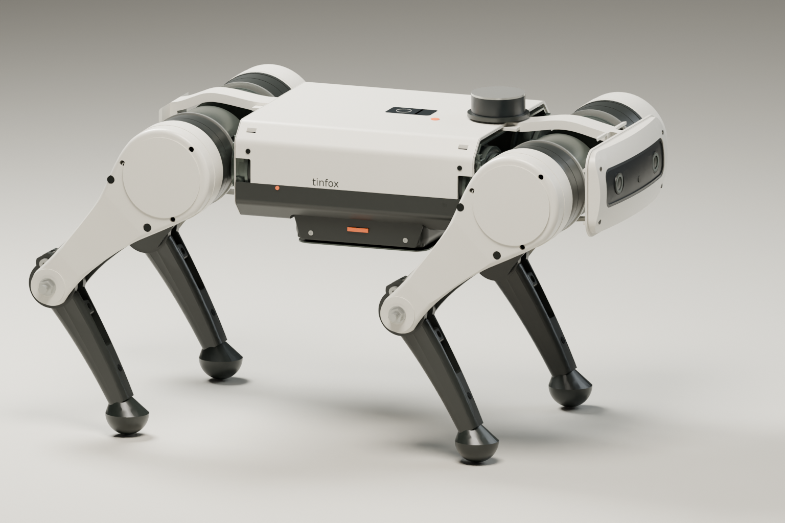

# Tinfox proposal B: sculpted panels and articulated collars

This quadruped proposal uses twelve RS-02 motors, proximal knee actuators,
single-pushrod knee transmissions and independent hip roll. Its precision-instrument
exterior combines ivory service panels and a curved front face, raised shoulder crowns, dark integrated
motor shrouds, tapered structural thighs and curved shin shells.

The [hardware and limb assembly review](model/review/hardware.html) records supplier
candidates, fit gaps and the bench assembly sequence. The motor cradle has a
two-piece printed clamshell whose outer half incorporates the service ring. Two fore/aft structural shin halves contain the bearing seats and pushrod rocker directly. Their split releases both bearings without an internal housing. The [print-strength review](model/review/strength.html) records layer direction and qualification limits. Axle clamp qualification,
roll bearing retainers and the motor tie clamp stack still require detail design.

[Compare printed, hybrid and metal limbs](http://127.0.0.1:8768/review/variants.html).
The electronics deck is a flat 4 mm PETG part with four top-access screws. The battery cassette has independent retention.
The printed limb set is an unloaded fit prototype; all three routes retain standard metal bearings, pins and fasteners.

[Open the assembly](http://127.0.0.1:8768/review/),
[inspect individual parts](http://127.0.0.1:8768/review/parts.html), or
[compare both proposals](http://127.0.0.1:8769/proposals/).



The whole limb uses a slimmer thigh web, a simple circular knee and a tapered
shin with one shallow 3.5 mm bow. Its two halves enclose a ribbed cavity that follows that curve. The [whole-limb profile](design/14-limb-profile.svg) compares the
preceding and revised geometry in open and folded poses. Hip, knee and foot
centers remain fixed.

The [assembly review](http://127.0.0.1:8768/review/assembly.html) shows the removable clamshell, isolated metal frame, tray and cassette.
The [manufacturing review](http://127.0.0.1:8768/review/manufacturing.html) provides oriented parts and unsliced H2D plates. The [front detail](design/15-body-detail.png) shows the continuous rounded nose,
168 mm recessed sensor opening and layered optical envelopes. The body keeps
a planar center bay and smooth shoulder transitions. The front fascia and bezel
have independent convex curves: 8 mm across the width and 10 mm top to bottom. The roof and both side walls form one removable clamshell. Two metal rails and
two transverse ties and a fixed lower brace connect the motor cartridges independently of the body covers and electronics deck.
The [body comparison](model/output/body-revision-comparison.json) records the revised
limb surfaces and compares body mass, skin samples, attachment fits and joint intervals.
The rendered geometry also includes
structural thigh covers, an articulated shoulder collar and rounded foot soles.
The [iteration record](design/iterations/README.md) preserves prior CAD passes and
their geometry fingerprints. The [original studio reference](design/studio-reference.png)
remains the styling target; its silhouette is not identical to the CAD.

| Dimension or estimate | Value |
| --- | ---: |
| Core torso length | 464 mm |
| Overall rigid nose-to-tail length | approximately 494 mm |
| Torso width / maximum height | 222.4 / 103.5 mm |
| Width across neutral shoulder caps | 325.0 mm |
| Central roof / shoulder crown above hip | 49.5 / 55.5 mm |
| Thigh / effective knee-to-ground reach | 170 / 170 mm |
| Foot-center distance / sole radius | 148 / 22 mm |
| Estimated base mass | 13.19 kg |
| Estimated mass with 1 kg cargo | 14.19 kg |

The wider fascia and local crowns prioritize the studio proportions. This adds
length and mass compared with the compact proposal. Electronics retain a
130 × 135 × 32 mm computer envelope; the underside cassette reserves two
125 × 85 × 65 mm battery-pack envelopes. Exact packs and adapters remain unselected.

The output contains [98 individual STEP parts](model/output/tinfox-individual-cad.zip),
including 12 motor-mount variants, a [named assembly](model/output/tinfox-assembly.step)
and [print-oriented STL prototypes](model/output/print-stl/).
STEP files retain assembly-local coordinates for Fusion 360. Printed-part STLs
use the orientations listed in the manufacturing review; the curved fascia faces
upward to keep support contact off its exterior. Supports, fits and printed
strength require qualification.

Eight preset poses have no checked rigid intersections and at least
1.50 mm nominal separation. Automated checks cover motion reports,
motor interfaces, STEP imports, print geometry, shin curvature and rounded-sole contact heights.
Browser checks exercise the presets, hip roll, section view and all mount downloads.
These are sampled geometry checks, not proof of loaded locomotion or continuous
trajectory clearance. Some simultaneous joint combinations collide. The [body roll audit](model/output/roll-shell-audit.json) records front-thigh contact with the belly or nose in deep tuck; the full roll range applies only to compatible hip/knee configurations.

The [engineering report](model/README.md) includes revised torque estimates and
their assumptions. The base remains above the 10 kg target, and several support
cases exceed the RS-02 rated reference. Loaded stairs, self-righting and running
remain unproven. Cables, cooling, flexible seals, foot retention, exact battery
adapters and tolerance drawings require further work. The 12-inch belly-clearance
target is unmet, and the replacement-leg cost target is unverified.

From the repository root, run:

```bash
tinfox/.venv/bin/python tinfox/proposals/sculpted/model/build.py
tinfox/.venv/bin/python tinfox/proposals/sculpted/model/export_parts.py
tinfox/.venv/bin/python tinfox/proposals/sculpted/model/audit_mounting.py
tinfox/.venv/bin/python tinfox/proposals/sculpted/model/audit_body.py
tinfox/.venv/bin/python tinfox/proposals/sculpted/model/audit_assembly.py
tinfox/.venv/bin/python tinfox/proposals/sculpted/model/engineering.py
tinfox/.venv/bin/python tinfox/proposals/sculpted/model/prepare_manufacturing.py
tinfox/.venv/bin/python tinfox/proposals/sculpted/model/analyze_limb_revision.py
tinfox/.venv/bin/python tinfox/proposals/sculpted/model/audit_limb_assembly.py
tinfox/.venv/bin/python tinfox/proposals/sculpted/model/audit_integration.py
tinfox/.venv/bin/python tinfox/proposals/sculpted/model/audit_roll_shell.py
tinfox/.venv/bin/python tinfox/proposals/sculpted/model/audit_print_strength.py
tinfox/.venv/bin/python tinfox/proposals/sculpted/model/make_fit_coupon.py
tinfox/.venv/bin/python tinfox/proposals/sculpted/model/write_hardware_review.py
tinfox/.venv/bin/python tinfox/proposals/sculpted/model/compare_body_revision.py
tinfox/.venv/bin/python tinfox/proposals/sculpted/model/check_refinement.py
tinfox/.venv/bin/python tinfox/proposals/sculpted/model/verify_manufacturing.py
tinfox/.venv/bin/python tinfox/proposals/sculpted/model/test_model.py
tinfox/.venv/bin/python tinfox/proposals/sculpted/model/write_assembly_guide.py
tinfox/.venv/bin/python tinfox/proposals/sculpted/model/write_report.py
tinfox/.venv/bin/python tinfox/proposals/sculpted/model/write_summary.py
tinfox/.venv/bin/python tinfox/proposals/sculpted/model/write_manufacturing_guide.py
tinfox/.venv/bin/python tinfox/proposals/sculpted/model/serve.py
```

Render with `model/render_studio.py --studio` in the Blender Python environment
described in [the engineering report](model/README.md). The neutral render omits
`--studio`. Run `model/verify_review.py` while port 8768 is serving the proposal.
Both render provenance files record the CAD fingerprint, camera and pose.

CAD fingerprint: `144a84e88daed50139f890480e9f1a1740cfb20c773e740ba6b4e9c1b9eede5e`.
